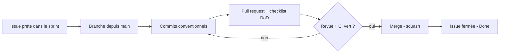

# Contribuer au Guichet Unique FNPSS

## Flux de travail

1. Prenez une issue au statut **Ready** dans le sprint courant et assignez-la-vous.
2. Créez une branche : `feat/REQ-06-formulaire-soumission`, `fix/123-upload-pdf`, `docs/GOV-07-specs`, `chore/OPS-01-ci`.
3. Commits au format [Conventional Commits](https://www.conventionalcommits.org/fr/) : `feat(requerant): ajoute le formulaire S3`.
4. Ouvrez une pull request avec `Closes #n`. Une PR = une issue, la plus petite possible (moins de 400 lignes si réaliste).
5. Au moins une approbation et une CI verte avant fusion (squash). Pas de commit direct sur `main`.

## Règles non négociables

- Aucun secret, clé privée de relayer ou donnée personnelle dans le dépôt ni dans les journaux.
- Aucune donnée personnelle sur la blockchain : seule l'empreinte SHA-256 est ancrée.
- Tout changement de smart contract passe par la revue d'un second développeur et des tests de non-régression.
- Les décisions structurantes sont consignées dans une issue de type **Décision (ADR)**.

## Definition of Ready

- Valeur et acteur identifiés, critères d'acceptation vérifiables
- Dépendances levées ou planifiées
- Estimée (points) et suffisamment petite pour tenir dans un sprint

## Definition of Done

- Code relu, PR approuvée, CI verte
- Tests automatisés ajoutés, critères d'acceptation vérifiés
- Documentation mise à jour
- Aucune vulnérabilité critique ou haute ouverte

## Versionnement

[SemVer](https://semver.org/lang/fr/) : `0.x` jusqu'au pilote (Alpha = `0.1.0`, Beta = `0.9.0`), `1.0.0` à la mise en production.
Les versions sont publiées via GitHub Releases, rattachées aux jalons M2, M3, M4.
