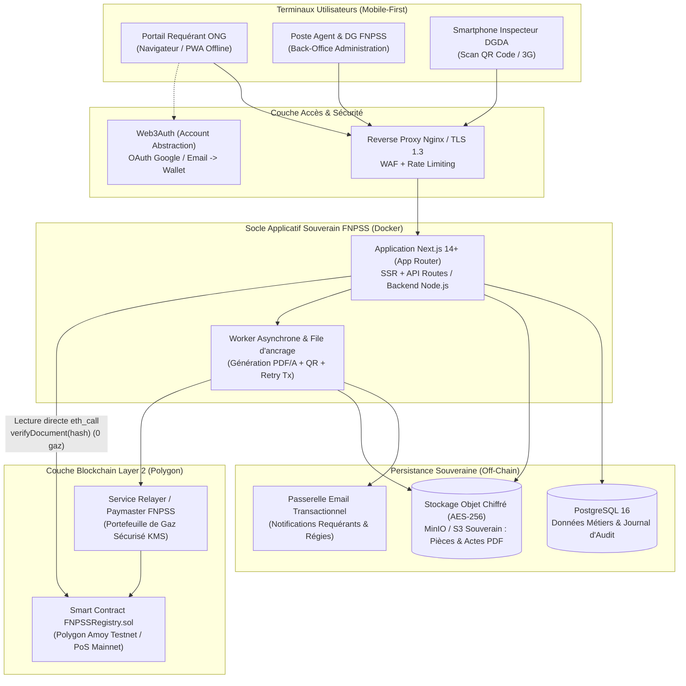
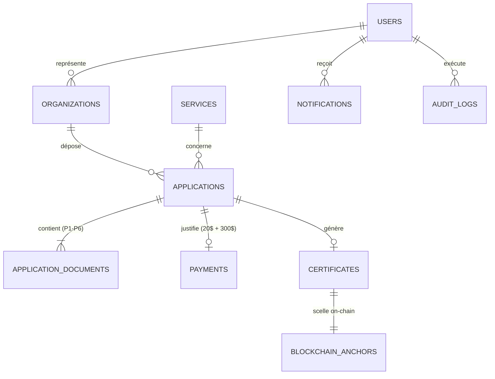

# Architecture Technique Hybride, Modèle de Données (MCD/SQL) et Spécification On-Chain

> **Références Backlog :** `GOV-08` (Architecture technique hybride UML, MCD, déploiement) · `OPS-03` (Schéma PostgreSQL) · `BLK-04` (Modèle de données on-chain & Smart Contract)
> **Sprint :** Sprint 0 (Semaines 1–2) · **Jalon associé :** `G1` (20/11/2026)

---

## 1. Vue d'Ensemble de l'Architecture Hybride Web2 / Web3 (`GOV-08`)

L'architecture du Guichet Unique FNPSS repose sur une séparation stricte entre :
1. **La couche métier et documentaire souveraine (Off-Chain / Web2) :** hébergée sous contrôle exclusif du FNPSS en RDC, elle stocke les comptes utilisateurs, les dossiers, les pièces justificatives chiffrées et génère les actes PDF officiels.
2. **La couche de notarisation et de vérification publique (On-Chain / Web3) :** hébergée sur **Polygon (Amoy Testnet / PoS Mainnet)**, elle ne reçoit **que le condensat SHA-256** et les métadonnées publiques de statut de chaque acte délivré.

### 1.1 Diagramme d'Architecture des Composants



---

## 2. Répartition des Données : Souveraineté Off-Chain vs Preuve On-Chain

| Catégorie de donnée | Stockage Off-Chain (PostgreSQL / MinIO FNPSS) | Stockage On-Chain (Polygon `FNPSSRegistry`) | Justification de sécurité et conformité |
|---|---|---|---|
| Identité du requérant (nom, email, téléphone, F92) | **Oui** (chiffré au repos) | **Non (Interdit)** | Protection des données personnelles et souveraineté nationale (`SEC-06`). |
| Pièces justificatives soumises (`P1` à `P6`) | **Oui** (chiffré `AES-256-GCM`) | **Non (Interdit)** | Confidentialité des projets humanitaires et maîtrise des coûts de stockage. |
| Quittances de frais (`20 USD` + `300 USD`) | **Oui** | **Non** | Donnée financière et comptable interne au FNPSS. |
| Acte officiel final (PDF/A signé avec QR Code) | **Oui** (coffre-fort numérique) | **Non** | Seul le détenteur légitime télécharge le PDF complet. |
| **Empreinte cryptographique du PDF (`bytes32 sha256Hash`)** | **Oui** (indexé) | **Oui (Immuable)** | Preuve mathématique infalsifiable d'intégrité du document. |
| **Numéro d'acte officiel (ex: `FNPSS-EXO-2026-00124`)** | **Oui** | **Oui** | Référence administrative publique vérifiable en douane. |
| **Code du service (`S1` à `S6`), dates d'émission/expiration, statut (`ACTIVE`/`REVOKED`)** | **Oui** | **Oui** | Permet au portail DGDA d'afficher la Pastille Verte/Rouge/Grise même en interrogeant directement la blockchain. |

---

## 3. Modèle Conceptuel et Schéma Relationnel PostgreSQL (`OPS-03`)

### 3.1 Diagramme Entité-Relation (ERD)



### 3.2 Structure des Tables Principales (SQL / Prisma)

```sql
-- 1. Rôles et Utilisateurs (RBAC : REQUERANT, AGENT, CHEF_DIVISION, DG, MINISTERE, DOUANE, ADMIN)
CREATE TYPE user_role AS ENUM ('REQUERANT', 'AGENT', 'CHEF_DIVISION', 'DG', 'MINISTERE', 'DOUANE', 'ADMIN');

CREATE TABLE users (
    id UUID PRIMARY KEY DEFAULT gen_random_uuid(),
    email VARCHAR(255) UNIQUE NOT NULL,
    password_hash VARCHAR(255),                 -- NULL si connexion exclusivement OAuth Google
    google_id VARCHAR(128) UNIQUE,
    wallet_address VARCHAR(42),                 -- Adresse EVM générée via Web3Auth (0x...)
    full_name VARCHAR(200) NOT NULL,
    phone VARCHAR(40),
    role user_role NOT NULL DEFAULT 'REQUERANT',
    is_active BOOLEAN NOT NULL DEFAULT TRUE,
    created_at TIMESTAMPTZ NOT NULL DEFAULT NOW(),
    updated_at TIMESTAMPTZ NOT NULL DEFAULT NOW()
);

-- 2. Organisations Requérantes (ONG, ASBL, Fondations, Mécènes)
CREATE TABLE organizations (
    id UUID PRIMARY KEY DEFAULT gen_random_uuid(),
    owner_user_id UUID NOT NULL REFERENCES users(id),
    legal_name VARCHAR(255) NOT NULL,
    acronym VARCHAR(50),
    org_type VARCHAR(60) NOT NULL,              -- ONG_NATIONALE, ONG_INTERNATIONALE, ASBL, FONDATION, ENTREPRISE
    registration_number VARCHAR(100),           -- N° F92 / Arrêté d'agrément / ID National
    fnpss_enrollment_number VARCHAR(100),       -- N° Attestation S1 si déjà enrôlée
    province VARCHAR(100) NOT NULL,
    address TEXT NOT NULL,
    legal_representative VARCHAR(200) NOT NULL,
    created_at TIMESTAMPTZ NOT NULL DEFAULT NOW()
);

-- 3. Catalogue des 6 Services du FNPSS (S1 à S6)
CREATE TABLE services (
    code VARCHAR(10) PRIMARY KEY,               -- 'S1', 'S2', 'S3', 'S4', 'S5', 'S6'
    title VARCHAR(255) NOT NULL,
    description TEXT NOT NULL,
    deposit_fee_usd NUMERIC(10,2) NOT NULL DEFAULT 20.00,
    inquiry_fee_usd NUMERIC(10,2) NOT NULL DEFAULT 300.00,
    sla_business_days INT NOT NULL DEFAULT 10,
    requires_ministry_signoff BOOLEAN NOT NULL DEFAULT FALSE,
    required_document_types JSONB NOT NULL      -- Liste paramétrable des pièces P1 à P6
);

-- 4. Demandes / Dossiers déposés
CREATE TYPE application_status AS ENUM (
    'BROUILLON',
    'SOUMIS',
    'EN_COURS_INSTRUCTION',
    'COMPLEMENT_REQUIS',
    'AVIS_FAVORABLE',
    'EN_VALIDATION_MINISTERE',
    'VALIDE_DELIVRE',
    'REJETE'
);

CREATE TABLE applications (
    id UUID PRIMARY KEY DEFAULT gen_random_uuid(),
    reference_number VARCHAR(50) UNIQUE NOT NULL, -- ex: FNPSS/DEM/2026/00048
    organization_id UUID NOT NULL REFERENCES organizations(id),
    service_code VARCHAR(10) NOT NULL REFERENCES services(code),
    submitted_by UUID NOT NULL REFERENCES users(id),
    assigned_agent_id UUID REFERENCES users(id),
    project_title VARCHAR(255) NOT NULL,
    project_summary TEXT NOT NULL,
    goods_metadata JSONB,                         -- Liste et valeur estimée des biens (pour S3, S4, S6)
    status application_status NOT NULL DEFAULT 'BROUILLON',
    rejection_or_complement_reason TEXT,
    submitted_at TIMESTAMPTZ,
    sla_started_at TIMESTAMPTZ,                   -- Déclenché à la validation du paiement (10j ouvrables)
    sla_due_at TIMESTAMPTZ,
    decided_at TIMESTAMPTZ,
    created_at TIMESTAMPTZ NOT NULL DEFAULT NOW(),
    updated_at TIMESTAMPTZ NOT NULL DEFAULT NOW()
);

-- 5. Pièces justificatives rattachées à une demande (P1 à P6)
CREATE TABLE application_documents (
    id UUID PRIMARY KEY DEFAULT gen_random_uuid(),
    application_id UUID NOT NULL REFERENCES applications(id) ON DELETE CASCADE,
    doc_type VARCHAR(50) NOT NULL,                -- 'P1_REQUETE', 'P2_ENROLEMENT', 'P3_PLAN_ACTION', 'P4_RAPPORT', 'P5_PROJET', 'P6_QUITTANCE'
    file_name VARCHAR(255) NOT NULL,
    mime_type VARCHAR(100) NOT NULL,
    file_size_bytes BIGINT NOT NULL,
    storage_key VARCHAR(512) NOT NULL,            -- Clé chiffrée dans le stockage objet
    sha256_hash CHAR(64) NOT NULL,                -- Empreinte calculée à l'upload
    is_compliant BOOLEAN,                         -- Contrôlé par l'agent instructeur
    agent_comment TEXT,
    uploaded_at TIMESTAMPTZ NOT NULL DEFAULT NOW()
);

-- 6. Paiements et Quittances de Frais (20 USD dépôt + 300 USD enquête)
CREATE TYPE payment_status AS ENUM ('EN_ATTENTE', 'PREUVE_DEPOSEE', 'VALIDE', 'REJETE');

CREATE TABLE payments (
    id UUID PRIMARY KEY DEFAULT gen_random_uuid(),
    application_id UUID UNIQUE NOT NULL REFERENCES applications(id),
    deposit_amount_usd NUMERIC(10,2) NOT NULL DEFAULT 20.00,
    inquiry_amount_usd NUMERIC(10,2) NOT NULL DEFAULT 300.00,
    amount_cdf NUMERIC(18,2),
    payment_channel VARCHAR(50) NOT NULL,         -- 'BORDEREAU_BANCAIRE', 'MOBILE_MONEY'
    transaction_reference VARCHAR(120) NOT NULL,
    receipt_document_id UUID REFERENCES application_documents(id),
    status payment_status NOT NULL DEFAULT 'PREUVE_DEPOSEE',
    validated_by UUID REFERENCES users(id),
    validated_at TIMESTAMPTZ,
    created_at TIMESTAMPTZ NOT NULL DEFAULT NOW()
);

-- 7. Actes Officiels Délivrés (Certificats, Attestations, Conventions, Arrêtés)
CREATE TYPE certificate_status AS ENUM ('ACTIVE', 'REVOKED', 'EXPIRED');

CREATE TABLE certificates (
    id UUID PRIMARY KEY DEFAULT gen_random_uuid(),
    application_id UUID UNIQUE NOT NULL REFERENCES applications(id),
    certificate_number VARCHAR(60) UNIQUE NOT NULL, -- ex: FNPSS-EXO-2026-00124
    service_code VARCHAR(10) NOT NULL REFERENCES services(code),
    pdf_storage_key VARCHAR(512) NOT NULL,
    pdf_sha256_hash CHAR(64) UNIQUE NOT NULL,       -- Empreinte exacte ancrée sur Polygon
    qr_verification_url TEXT NOT NULL,
    issued_by UUID NOT NULL REFERENCES users(id),
    issued_at TIMESTAMPTZ NOT NULL DEFAULT NOW(),
    expires_at TIMESTAMPTZ,
    status certificate_status NOT NULL DEFAULT 'ACTIVE',
    revoked_by UUID REFERENCES users(id),
    revoked_at TIMESTAMPTZ,
    revocation_reason TEXT
);

-- 8. Ancrage et File d'attente Blockchain
CREATE TYPE anchor_tx_status AS ENUM ('QUEUED', 'SUBMITTED', 'CONFIRMED', 'FAILED');

CREATE TABLE blockchain_anchors (
    id UUID PRIMARY KEY DEFAULT gen_random_uuid(),
    certificate_id UUID UNIQUE NOT NULL REFERENCES certificates(id),
    network VARCHAR(40) NOT NULL,                   -- 'polygon-amoy' ou 'polygon-mainnet'
    contract_address VARCHAR(42) NOT NULL,
    tx_hash VARCHAR(66) UNIQUE,
    block_number BIGINT,
    tx_status anchor_tx_status NOT NULL DEFAULT 'QUEUED',
    retry_count INT NOT NULL DEFAULT 0,
    last_error TEXT,
    confirmed_at TIMESTAMPTZ,
    created_at TIMESTAMPTZ NOT NULL DEFAULT NOW()
);

-- 9. Journal d'Audit Immuable (F18 / ADM-07)
CREATE TABLE audit_logs (
    id BIGSERIAL PRIMARY KEY,
    actor_user_id UUID REFERENCES users(id),
    actor_role VARCHAR(40),
    action VARCHAR(100) NOT NULL,                   -- ex: 'APPLICATION_SUBMITTED', 'PAYMENT_VALIDATED', 'CERTIFICATE_ISSUED', 'QR_VERIFIED'
    target_type VARCHAR(60) NOT NULL,
    target_id VARCHAR(100) NOT NULL,
    metadata JSONB,
    ip_address VARCHAR(45),
    created_at TIMESTAMPTZ NOT NULL DEFAULT NOW()
);
```

---

## 4. Spécification du Modèle On-Chain et Smart Contract (`BLK-04`, `BLK-05`, `BLK-07`)

### 4.1 Données stockées On-Chain (`Struct DocumentRecord`)
Conformément à la règle d'or de confidentialité, le contrat intelligent **`FNPSSRegistry.sol`** stocke uniquement :
* `bytes32 docHash` : condensat SHA-256 du PDF officiel (clé primaire du mapping).
* `string certificateNumber` : identifiant administratif (ex. `FNPSS-EXO-2026-00124`).
* `uint8 serviceCode` : `1` à `6` (pour `S1` à `S6`).
* `uint64 issuedAt` : timestamp Unix d'émission.
* `uint64 expiresAt` : timestamp Unix d'expiration (`0` si permanent).
* `Status status` : `NONE (0)`, `ACTIVE (1)`, `REVOKED (2)`.
* `address issuer` : adresse du signataire / relayer habilité du FNPSS.
* `string revocationReason` : code motif en cas de révocation administrative (`CU06`).

### 4.2 Interface de Référence du Smart Contract (`FNPSSRegistry.sol`)

```solidity
// SPDX-License-Identifier: MIT
pragma solidity ^0.8.24;

import "@openzeppelin/contracts/access/AccessControl.sol";
import "@openzeppelin/contracts/utils/Pausable.sol";

/**
 * @title FNPSSRegistry
 * @notice Registre officiel d'ancrage et de vérification des actes du Guichet Unique FNPSS (RDC)
 * @dev Aucune donnée personnelle n'est stockée on-chain (uniquement le hash SHA-256 et les métadonnées de validité).
 */
contract FNPSSRegistry is AccessControl, Pausable {
    bytes32 public constant REGISTRAR_ROLE = keccak256("REGISTRAR_ROLE");
    bytes32 public constant REVOKER_ROLE   = keccak256("REVOKER_ROLE");

    enum DocStatus { NONE, ACTIVE, REVOKED }

    struct DocumentRecord {
        string certificateNumber;
        uint8 serviceCode;       // 1 = S1 ... 6 = S6
        uint64 issuedAt;
        uint64 expiresAt;        // 0 = sans expiration
        DocStatus status;
        address issuer;
        uint64 revokedAt;
        string revocationReason;
    }

    mapping(bytes32 => DocumentRecord) private _records;

    event DocumentRegistered(
        bytes32 indexed docHash,
        string certificateNumber,
        uint8 indexed serviceCode,
        uint64 issuedAt,
        uint64 expiresAt,
        address indexed issuer
    );

    event DocumentRevoked(
        bytes32 indexed docHash,
        string certificateNumber,
        uint64 revokedAt,
        string reason,
        address indexed revokedBy
    );

    constructor(address admin, address relayer) {
        _grantRole(DEFAULT_ADMIN_ROLE, admin);
        _grantRole(REGISTRAR_ROLE, relayer);
        _grantRole(REVOKER_ROLE, admin);
        _grantRole(REVOKER_ROLE, relayer);
    }

    function registerDocument(
        bytes32 docHash,
        string calldata certificateNumber,
        uint8 serviceCode,
        uint64 expiresAt
    ) external onlyRole(REGISTRAR_ROLE) whenNotPaused {
        require(docHash != bytes32(0), "Invalid hash");
        require(_records[docHash].status == DocStatus.NONE, "Already registered");
        require(serviceCode >= 1 && serviceCode <= 6, "Invalid service code");

        uint64 nowTs = uint64(block.timestamp);
        _records[docHash] = DocumentRecord({
            certificateNumber: certificateNumber,
            serviceCode: serviceCode,
            issuedAt: nowTs,
            expiresAt: expiresAt,
            status: DocStatus.ACTIVE,
            issuer: msg.sender,
            revokedAt: 0,
            revocationReason: ""
        });

        emit DocumentRegistered(docHash, certificateNumber, serviceCode, nowTs, expiresAt, msg.sender);
    }

    function revokeDocument(
        bytes32 docHash,
        string calldata reason
    ) external onlyRole(REVOKER_ROLE) whenNotPaused {
        DocumentRecord storage rec = _records[docHash];
        require(rec.status == DocStatus.ACTIVE, "Not active");
        require(bytes(reason).length > 0, "Reason required");

        uint64 nowTs = uint64(block.timestamp);
        rec.status = DocStatus.REVOKED;
        rec.revokedAt = nowTs;
        rec.revocationReason = reason;

        emit DocumentRevoked(docHash, rec.certificateNumber, nowTs, reason, msg.sender);
    }

    function verifyDocument(bytes32 docHash)
        external
        view
        returns (
            bool isValid,
            DocStatus status,
            string memory certificateNumber,
            uint8 serviceCode,
            uint64 issuedAt,
            uint64 expiresAt,
            address issuer,
            uint64 revokedAt,
            string memory revocationReason
        )
    {
        DocumentRecord memory rec = _records[docHash];
        bool notExpired = (rec.expiresAt == 0 || block.timestamp <= rec.expiresAt);
        bool valid = (rec.status == DocStatus.ACTIVE && notExpired);
        return (
            valid,
            rec.status,
            rec.certificateNumber,
            rec.serviceCode,
            rec.issuedAt,
            rec.expiresAt,
            rec.issuer,
            rec.revokedAt,
            rec.revocationReason
        );
    }
}
```

---

## 5. Sécurité, Résilience et Déploiement (`OPS-02`, `OPS-05`, `OPS-07`)

1. **Ordre de scellement du PDF et du QR Code (Prévention du paradoxe de hachage) :**
   * L'identifiant unique de l'acte (`certificate_number`) et le jeton de vérification (`verificationId`) sont générés **avant** l'assemblage du PDF.
   * Le QR Code pointant vers `https://guichet.fnpss.cd/verifier/{sha256_ou_id}` est incrusté dans le PDF final.
   * Le hash **SHA-256** est calculé sur les octets exacts de ce PDF final complet, puis ancré dans `FNPSSRegistry.sol`. Ainsi, **tout recalcul d'empreinte du fichier PDF téléchargé par l'ONG ou contrôlé par la DGDA (`VER-04`) tombe exactement sur le hash inscrit sur la blockchain**.
2. **Protection de la clé du Relayer (`R10` / `BLK-09`) :**
   * La clé privée détentrice du rôle `REGISTRAR_ROLE` est isolée dans un gestionnaire de secrets chiffré avec plafond quotidien de transactions et alerte de solde POL/MATIC bas.
   * L'administrateur `DEFAULT_ADMIN_ROLE` est détenu par un portefeuille multisig froid du FNPSS permettant de révoquer instantanément un relayer compromis.
3. **Sauvegarde et Reprise d'Activité (`OPS-05`) :**
   * Base PostgreSQL sauvegardée quotidiennement (`pg_dump` chiffré + WAL archiving) avec rétention de 30 jours et test de restauration mensuel.

