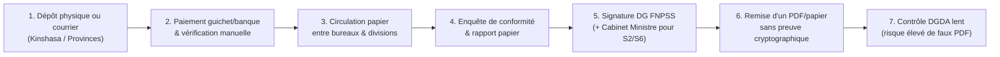
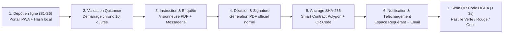

# Cartographie des Flux de Validation (S1 à S6) et Guide des Ateliers Métier

> **Références Backlog :** `GOV-03` (Ateliers de co-création avec les directions du FNPSS) · `GOV-04` (Cartographie des flux de validation actuels et cibles)
> **Sprint :** Sprint 0 (Semaines 1–2 : 02/11 → 13/11/2026) · **Jalon associé :** `G1` (20/11/2026)

---

## 1. Protocole des Ateliers de Co-Création (`GOV-03`)

### 1.1 Planning des sessions de la Semaine 1 (02/11 → 06/11/2026)

| Session | Direction / Entité consultée | Services couverts | Objectif de la session (2h) |
|---|---|---|---|
| **Atelier A1** | Direction des Études, de la Planification et des Partenariats (FNPSS) | **S1** (Attestation d'enrôlement), **S2** (Convention de partenariat), **S5** (Certificat de philanthropie) | Valider les critères d'éligibilité des ONG/mécènes, la liste exacte des pièces exigées et le gabarit officiel des actes. |
| **Atelier A2** | Direction des Opérations Sociales & Exonérations Humanitaires (FNPSS) | **S3** (Attestation des biens à exonérer), **S4** (Certificat d'exonérations), **S6** (Arrêté ministériel d'avis favorable) | Cartographier le contrôle des listes de colisage, le déroulement de l'enquête de conformité (`300 USD`) et les motifs fréquents de rejet ou demande de complément. |
| **Atelier A3** | Direction Administrative et Financière (DAF FNPSS) | Transverse (`S1` à `S6`) — Frais administratifs (`F06`) | Définir le circuit de vérification des preuves de paiement (`20 USD` frais de dépôt + `300 USD` frais d'enquête en équivalent CDF) et le point de départ du délai de 10 jours ouvrables. |
| **Atelier A4** | Cellule Juridique FNPSS, Cabinet du Ministère de Tutelle & **DGDA** | Transverse (`S2`, `S4`, `S6`) & Contrôle Douanier (`F15`, `F16`) | Valider les signataires finaux, les mentions obligatoires sur le PDF scellé et les informations affichées lors du scan du QR Code aux postes frontières. |

### 1.2 Grille d'entretien standard par service
1. **Entrées :** Quelles informations du formulaire et quelles pièces jointes sont strictement obligatoires (bloquantes) vs facultatives ?
2. **Contrôle de recevabilité :** Quelles sont les 3 causes principales de rejet ou de renvoi pour complément aujourd'hui ?
3. **Circuit de validation :** Qui instruit, qui vise, qui signe en dernier ressort ? Quels sont les délais réels constatés à chaque étape ?
4. **Sortie :** Quel est le modèle exact du document délivré (numérotation, durée de validité, conditions de révocation) ?

---

## 2. Synthèse Comparative des 6 Services du Guichet Unique (`GOV-04`)

| Code | Intitulé du Service | Public Cible | Frais de Dépôt | Frais d'Enquête | Délai Cible | Signataire(s) de l'Acte Final | Validité / Usage Douanier |
|---|---|---|---|---|---|---|---|
| **S1** | **Attestation d'enrôlement au FNPSS** | ONG nationales/internationales, ASBL, Fondations | 20 USD *(éq. CDF)* | 300 USD *(éq. CDF)* | 10 jours ouvrables | Direction Générale (DG) du FNPSS | Prérequis obligatoire pour les démarches `S2` à `S6`. |
| **S2** | **Convention de partenariat avec le Gouvernement de la RDC** | ONG et partenaires opérant des programmes sociaux | 20 USD *(éq. CDF)* | 300 USD *(éq. CDF)* | 10 jours ouvrables *(hors contre-seing)* | DG FNPSS + Ministère de Tutelle (Affaires Sociales) | Cadre pluriannuel d'intervention humanitaire/sociale. |
| **S3** | **Attestation des biens à exonérer** | ONG/Partenaires important du matériel ou vivres | 20 USD *(éq. CDF)* | 300 USD *(éq. CDF)* | 10 jours ouvrables | Direction Générale (DG) du FNPSS | Certifie la liste qualitative/quantitative des biens humanitaires. |
| **S4** | **Certificat d'exonérations** | ONG/Partenaires titulaires d'un programme actif | 20 USD *(éq. CDF)* | 300 USD *(éq. CDF)* | 10 jours ouvrables | Direction Générale (DG) du FNPSS | Présenté à la **DGDA** / DGRAD avec vérification par QR Code. |
| **S5** | **Certificat de philanthropie** | Donateurs, mécènes, fondations et entreprises | 20 USD *(éq. CDF)* | 300 USD *(éq. CDF)* | 10 jours ouvrables | Direction Générale (DG) du FNPSS | Reconnaissance officielle d'utilité sociale et fiscale. |
| **S6** | **Arrêté ministériel portant avis favorable pour l'exonération** | ONG/Partenaires sollicitant une franchise douanière/fiscale | 20 USD *(éq. CDF)* | 300 USD *(éq. CDF)* | 10 jours ouvrables *(instruction FNPSS)* | Ministre de Tutelle (après avis technique du DG FNPSS) | Acte réglementaire transmis aux Finances/Budget et contrôlé par la **DGDA**. |

---

## 3. Pièces Exigées et Règles de Gestion Documentaire

Conformément au référentiel métier ([GUICHET UNIQUE FNPSS.pdf](GUICHET%20UNIQUE%20FNPSS.pdf)), tout dépôt de demande s'accompagne du dossier standardisé suivant :

| # | Pièce justificative exigée | Format | Obligatoire pour | Contrôle de recevabilité effectué par l'agent |
|---|---|---|---|---|
| **P1** | **Requête adressée au Ministre** de tutelle avec copie au DG du FNPSS (ou adressée au DG selon le service) | PDF/A signé | `S1`, `S2`, `S3`, `S4`, `S5`, `S6` | Vérification de l'en-tête de l'ONG, de l'objet de la demande et de la signature du représentant légal. |
| **P2** | **Copie de l'attestation d'enrôlement au FNPSS** | PDF/A | `S2`, `S3`, `S4`, `S5`, `S6` *(exempté pour une 1re demande `S1`)* | Vérification du numéro d'enrôlement FNPSS et de sa validité (automatisable dès que `S1` est émis sur le portail). |
| **P3** | **Copie du plan d'action** pour l'année en cours | PDF/A | `S1`, `S2`, `S3`, `S4`, `S5`, `S6` | Cohérence des objectifs opérationnels et des zones géographiques d'intervention en RDC. |
| **P4** | **Copie du rapport annuel d'activités** de l'exercice écoulé | PDF/A | `S1`, `S2`, `S3`, `S4`, `S5`, `S6` | Vérification de l'effectivité des actions menées sur le terrain. |
| **P5** | **Projet ou programme social/humanitaire détaillé** (+ liste valorisée des biens pour `S3`, `S4`, `S6`) | PDF/A | `S1`, `S2`, `S3`, `S4`, `S5`, `S6` | Adéquation entre la nature/quantité des biens importés (véhicules, intrants médicaux, vivres) et les besoins du projet. |
| **P6** | **Preuve de paiement des frais** (`20 USD` dépôt + `300 USD` enquête de conformité, en CDF) | PDF / Image | `S1`, `S2`, `S3`, `S4`, `S5`, `S6` | Concordance du montant, de la référence bancaire/quittance et validation comptable déclenchant le compte à rebours de **10 jours ouvrables**. |

> [!TIP]
> **Optimisation « Once-Only » (Dites-le-nous une seule fois — `F02`) :** Les pièces institutionnelles déjà validées lors de l'enrôlement (`S1`), telles que les statuts/F92, le plan d'action annuel (`P3`) et le rapport annuel (`P4`), sont rattachées au profil de l'ONG pour éviter leur re-téléversement systématique lors des demandes `S3`, `S4` et `S6` de la même année.

---

## 4. Cartographie des Flux : Actuel (*As-Is*) vs Cible (*To-Be*)

### 4.1 Flux Actuel (*As-Is*) et Points de Friction Identifiés

#### Points de friction majeurs relevés (`GOV-04`)
1. **Rupture géographique (Provinces → Kinshasa) :** Une ONG basée au Nord-Kivu, au Kasaï ou au Katanga doit mandater un représentant à Kinshasa pour déposer le dossier papier et suivre son avancement.
2. **Absence de jalonnement du délai de 10 jours :** Sans horodatage numérique de la validation des frais (`20 USD` + `300 USD`), le point de départ du délai de 10 jours ouvrables est source de litiges.
3. **Pertes de temps sur dossiers incomplets :** L'absence d'une pièce ou d'une signature n'est parfois signalée qu'après plusieurs semaines de circulation interne.
4. **Vulnérabilité critique en douane (DGDA) :** Un certificat papier ou PDF standard peut être altéré (modification des quantités de biens, de la date d'expiration ou du nom de l'ONG) sans que l'inspecteur au poste frontière puisse vérifier instantanément la source auprès du FNPSS.

### 4.2 Flux Cible Dématérialisé et Notarisé (*To-Be*)

---

## 5. Circuit de Validation par Catégorie de Service

### 5.1 Actes à signature directe FNPSS (`S1`, `S3`, `S4`, `S5`)
1. **Dépôt (`Soumis`) :** Le requérant soumet le formulaire et les pièces `P1` à `P6`.
2. **Recevabilité & Frais (`En cours d'instruction`) :** L'agent FNPSS vérifie la complétude documentaire et la preuve de paiement (`20 USD` + `300 USD`). Si une pièce est non conforme, passage à `Complément requis` avec notification immédiate et suspension temporaire du compteur de 10 jours.
3. **Enquête & Avis technique (`Avis favorable émis`) :** Réalisation de l'enquête de conformité et validation par le Chef de Division métier.
4. **Approbation & Scellement (`Délivré`) :** Approbation par la Direction Générale du FNPSS, génération du PDF officiel, ancrage du hash **SHA-256** sur la blockchain, incrustation du **QR Code** et notification automatique au requérant.

### 5.2 Actes conjoints ou ministériels (`S2` Convention, `S6` Arrêté ministériel)
1. **Étapes 1 à 3 identiques** au sein du FNPSS (instruction technique et avis favorable motivé du DG FNPSS).
2. **Étape 3 bis (`En validation ministérielle`) :** Transmission du dossier instruit et du projet d'acte au Ministère de tutelle (Affaires Sociales).
3. **Étape 4 (`Délivré`) :** Après signature ministérielle, l'acte officiel final est scellé sur la blockchain (hash SHA-256 + QR Code dynamique) et mis à disposition du requérant et des régies financières (DGDA).

