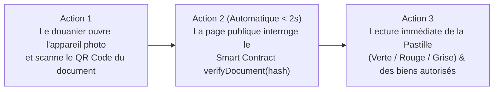

# Personas et Parcours Utilisateurs (UX/UI) — Guichet Unique FNPSS

> **Référence Backlog :** `UX-01` (Définir les personas et les parcours : requérant, agent, DG, ministère, douane)
> **Sprint :** Sprint 0 (Semaines 1–2 : 02/11 → 13/11/2026) · **Jalon associé :** `G1` (20/11/2026)
> **Dépendances aval :** `UX-02` (Wireframes Requérant), `UX-03` (Wireframes Back-Office), `UX-06` (Écran Douanier QR Code)

---

## 1. Les 5 Personas Clés du Système (`UX-01`)

### Persona 1 — Chantal M., Coordinatrice Logistique & Administrative d'une ONG (Requérant)
* **Profil :** 38 ans, basée à **Goma (Nord-Kivu)** avec des déplacements fréquents en zones rurales. Coordonne l'importation d'intrants médicaux et de kits humanitaires d'urgence.
* **Équipement & Connectivité :** Ordinateur portable au bureau (connexion 3G/4G instable, coupures électriques fréquentes) et smartphone Android milieu de gamme en déplacement.
* **Objectifs :**
  * Obtenir rapidement l'attestation des biens à exonérer (`S3`), le certificat d'exonérations (`S4`) et l'arrêté ministériel (`S6`) sans devoir envoyer un coursier à Kinshasa.
  * Savoir exactement où en est son dossier dans le délai annoncé de **10 jours ouvrables**.
* **Frustrations actuelles :**
  * Formulaires qui perdent toute la saisie lors d'une micro-coupure internet au moment d'envoyer un fichier PDF de 5 Mo.
  * Rejets tardifs pour une pièce manquante sans explication précise.
  * Complexité technique : ne connaît rien à la blockchain ni aux portefeuilles cryptographiques.
* **Exigences UX pour Chantal :**
  * **Sauvegarde automatique hors-ligne (PWA / IndexedDB)** à chaque étape du formulaire (*Wizard*).
  * Reprise d'upload résiliente et compression/validation des PDF côté client.
  * **Zéro jargon Web3** : connexion classique par email ou Google (`Web3Auth` invisible en arrière-plan).

---

### Persona 2 — Patrick K., Agent Instructeur au FNPSS (Back-Office Métier)
* **Profil :** 34 ans, basé au siège du **FNPSS à Kinshasa**. Instruit quotidiennement entre 15 et 30 dossiers couvrant les 6 services (`S1` à `S6`).
* **Équipement & Connectivité :** PC de bureau (écran 19–24 pouces) sur le réseau local du FNPSS.
* **Objectifs :**
  * Identifier en un coup d'œil les nouveaux dossiers par service et les dossiers dont le délai de 10 jours ouvrables approche.
  * Vérifier les 6 pièces jointes (`P1` à `P6`) et la quittance de frais (`20 USD` + `300 USD`) sans télécharger des dizaines de fichiers sur son poste.
* **Frustrations actuelles :**
  * Dossiers papier incomplets, allers-retours téléphoniques non tracés avec les ONG.
  * Difficulté à retrouver l'historique des demandes précédentes d'une même ONG.
* **Exigences UX pour Patrick :**
  * **Tableau de bord avec compteurs par service (`S1`–`S6`)** et alertes de SLA (code couleur vert / orange / rouge selon le nombre de jours ouvrés écoulés).
  * **Visionneuse PDF intégrée côte à côte** avec la check-list de conformité des pièces (`ADM-05`).
  * Modèles de réponses pré-rédigés pour notifier un « Complément requis » en 2 clics.

---

### Persona 3 — Jean-Pierre L., Membre de la Direction Générale du FNPSS (Autorité de Validation)
* **Profil :** 52 ans, cadre dirigeant à **Kinshasa**, emploi du temps très chargé, consulte souvent ses dossiers entre deux réunions institutionnelles.
* **Équipement & Connectivité :** Ordinateur portable et tablette/smartphone haut de gamme.
* **Objectifs :**
  * Disposer d'une synthèse claire et fiable du dossier instruit (avis de l'agent, conformité des frais et de l'enquête) avant d'apposer sa validation finale.
  * Pouvoir **révoquer immédiatement** (`VER-06`) un certificat si une fraude ou un détournement d'usage est signalé sur le terrain.
* **Exigences UX pour la Direction Générale :**
  * Vue « Prêt pour décision / signature » épurée, affichant la fiche de synthèse, l'aperçu de l'acte officiel normé et un bouton d'approbation sécurisé (avec double confirmation).
  * Déclenchement automatique et transparent de l'ancrage blockchain (`registerDocument`) et de la génération du QR Code lors de la publication.

---

### Persona 4 — Conseiller Point Focal au Ministère de Tutelle / Finances (Acteur Inter-Institutionnel)
* **Profil :** 45 ans, membre de cabinet ministériel à **Kinshasa**, intervient sur les actes conjoints (`S2` Convention de partenariat, `S6` Arrêté ministériel d'avis favorable).
* **Équipement & Connectivité :** Ordinateur portable ou smartphone.
* **Objectifs :**
  * Vérifier que le dossier transmis par le FNPSS est complet et bénéficie bien d'un avis technique favorable du FNPSS avant contre-seing ministériel.
* **Exigences UX pour le Point Focal Ministériel :**
  * Accès restreint aux seuls dossiers `S2` et `S6` à l'état `Avis favorable FNPSS`.
  * Consultation rapide du dossier scellé et téléversement/validation de l'arrêté signé sans manipulation complexe.

---

### Persona 5 — Inspecteur Thierry B., Agent de Contrôle Douanier DGDA (Vérificateur Terrain)
* **Profil :** 41 ans, inspecteur de la **DGDA** en poste frontière (Kasumbalesa, Matadi, Aéroport de N'Djili ou Goma). Contrôle les camions et cargaisons humanitaires sous pression temporelle forte.
* **Équipement & Connectivité :** Smartphone personnel ou professionnel sous Android, utilisé **en extérieur (plein soleil)** avec une connexion **2G/3G parfois dégradée**.
* **Objectifs :**
  * Vérifier en **moins de 3 secondes** si le certificat d'exonération papier présenté par le déclarant ou le chauffeur est **authentique, non modifié, non révoqué et non expiré**.
  * Comparer la liste des marchandises présentes dans le camion avec la liste certifiée par le FNPSS.
* **Frustrations actuelles :**
  * Impossible de distinguer à l'œil nu un vrai certificat FNPSS d'un PDF falsifié.
  * Aucun moyen de joindre les bureaux de Kinshasa en dehors des heures ouvrées.
* **Exigences UX pour l'Inspecteur DGDA (`UX-06`, `VER-03`) :**
  * **Zéro connexion requise (accès public direct par scan du QR Code)** : ouverture directe de `guichet.fnpss.cd/verifier/[hash]`.
  * **Interface à contraste maximal (lisible en plein soleil)** affichant un verdict visuel plein écran :
    * 🟢 **PASTILLE VERTE : AUTHENTIQUE & VALIDE** (Nom de l'ONG, N° d'acte, dates de validité, liste/quota des biens exonérés, preuve blockchain `TxHash`).
    * 🔴 **PASTILLE ROUGE : ALERTE — DOCUMENT FALSIFIÉ OU RÉVOQUÉ** (Consigne d'immobilisation immédiate).
    * ⚪ **PASTILLE GRISE : CERTIFICAT EXPIRÉ** (Date d'échéance dépassée).

---

## 2. Parcours Utilisateurs de Bout en Bout (*User Journeys*)

### 2.1 Parcours Requérant ONG (Soumission S1 à S6)

| Étape | Action de l'utilisateur | Réponse du système (Portail Guichet Unique) | Point d'attention UX / Technique |
|---|---|---|---|
| **1. Accès & Compte** | Ouvre le portail, clique sur « Créer un compte » ou « Connexion Google ». | Authentifie l'usager et initialise son identité Web3Auth de manière invisible. | Pré-remplissage nom/post-nom via Google OAuth (`REQ-02`). |
| **2. Profil ONG** | Renseigne une seule fois les informations de l'ONG (dénomination, F92, représentant). | Enregistre le profil et conserve les pièces annuelles déjà validées. | Principe *Once-Only* pour accélérer les démarches suivantes (`REQ-04`). |
| **3. Choix du Service** | Depuis son tableau de bord, clique sur « Commencer par ici » sous l'un des 6 services (`S1` à `S6`). | Affiche les prérequis, les frais (`20 USD` + `300 USD`) et le délai de 10 jours ouvrables. | Cartes visuelles claires avec compteurs de demandes (`REQ-05`). |
| **4. Saisie & Pièces** | Remplit le formulaire en 3 étapes et joint les PDF exigés + la preuve de paiement. | Calcule le hash SHA-256 local de chaque pièce, sauvegarde le brouillon en local (PWA) et valide les formats. | Barre de progression par fichier et reprise automatique si coupure 3G (`REQ-07`, `REQ-11`). |
| **5. Suivi Temps Réel** | Consulte l'état de sa demande (`Soumis` → `En cours` → `Validé`) ou répond à une demande de complément. | Envoie des notifications par email et dans le centre de notifications du portail. | Possibilité d'exporter ses demandes en CSV/Excel/PDF (`REQ-08`). |
| **6. Réception de l'Acte** | Reçoit la notification de disponibilité et télécharge son acte officiel PDF scellé. | Délivre le PDF normé comportant l'identifiant unique national et le **QR Code dynamique**. | Téléchargement journalisé et vérifiable hors-ligne (`REQ-09`). |

### 2.2 Parcours Contrôle Douanier en 3 Actions (` < 3 secondes `)

---

## 3. Exigences Ergonomiques et Contraintes Terrain (RDC)

| Contrainte Terrain | Impact Utilisateur | Réponse UX/UI et Architecture (`UX-05`, `REQ-11`, `REQ-12`) |
|---|---|---|
| **Bande passante faible (2G/3G en province et aux frontières)** | Temps de chargement lents, échecs d'envoi de formulaires | Budget de poids strict (**< 150 Ko JS initial** sur la page de vérification douanière), rendu côté serveur (SSR Next.js), absence de bibliothèques lourdes inutiles. |
| **Micro-coupures réseau pendant le dépôt d'un dossier** | Perte des champs saisis et découragement des ONG | Sauvegarde automatique instantanée du brouillon dans `IndexedDB` et file d'attente d'envoi asynchrone (*Background Sync PWA*). |
| **Lecture sur écran mobile en plein soleil (Postes DGDA)** | Faible lisibilité des textes gris clair ou petits | Ratios de contraste **WCAG AAA (> 7:1)** sur l'écran de vérification, police minimale `16px`, icônes doublant systématiquement la couleur (✓ Valide / ✕ Falsifié / ⌛ Expiré). |
| **Utilisateurs non familiers avec la blockchain** | Crainte ou incompréhension des clés privées et frais de gaz | Abstraction totale : aucune *seed phrase*, aucun portefeuille MetaMask requis, frais de gaz intégralement supportés par le *Relayer* du FNPSS. |

