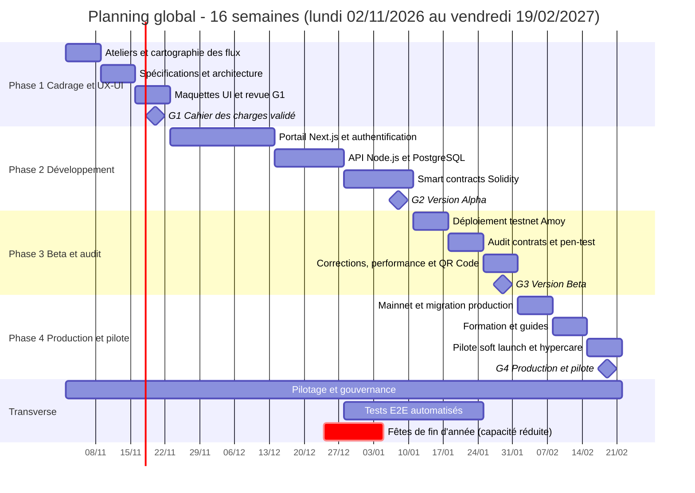
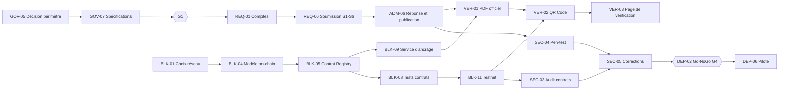
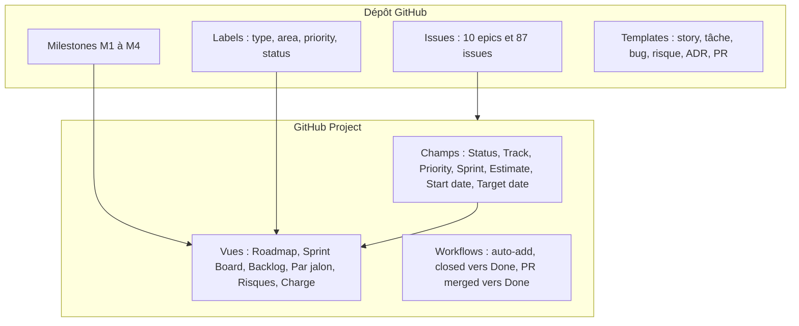

# Planification globale du projet Guichet Unique FNPSS

> **Statut :** proposition à valider au COPIL de lancement · **Version :** 1.0 · **Auteur :** équipe projet
> **Sources :** [GUICHET UNIQUE FNPSS.pdf](GUICHET%20UNIQUE%20FNPSS.pdf), [Note technique Blockchain V3](Note_Technique_FNPSS_Blockchain_V3.pdf) (V2 pour comparaison), [spécifications fonctionnelles](SPECIFICATIONS_FONCTIONNELLES_ET_CAS_UTILISATION.md).
> **Pilotage :** [GitHub Project, jalons et issues](../.github/planning/README.md), généré depuis [backlog.json](../.github/planning/backlog.json).

---

## 1. Synthèse exécutive

| Élément | Valeur |
|---|---|
| Durée | **16 semaines** en 4 phases (note technique V3, §4) |
| Méthode | Agile Scrum : 8 sprints (Sprint 0 de 3 semaines, Sprints 1 à 6 de 2 semaines, Sprint 7 de 1 semaine) |
| Jalons | G1 cadrage · G2 Alpha · G3 Beta et audit · G4 production et pilote |
| Budget de réalisation | **11 000 USD HT** (V3) · coûts récurrents **4 700 USD/an** |
| Périmètre | Portail requérant, back-office, notifications, ancrage blockchain, QR Code et vérification douanière |
| Backlog | **10 epics · 87 issues · 409 points** (70 Must, 14 Should, 3 Could) |
| Calendrier | Lundi **02/11/2026** (confirmé) → vendredi **19/02/2027** |

### Décisions à prendre avant G1 (20/11/2026)

| # | Décision | Pourquoi c'est bloquant | Issue |
|---|---|---|---|
| D1 | Traitement **manuel conservé** ou **workflow numérique complet** ? | La présentation du guichet dit que le traitement reste manuel et que le FNPSS notifie en fin de traitement. La note blockchain prévoit des validations multi-acteurs et des signatures numériques. | GOV-05 |
| D2 | Canal de paiement des frais (20 USD dépôt, 300 USD enquête) | Les montants et le délai de 10 jours ouvrables sont définis, pas le mode de paiement. | GOV-11 |
| D3 | Budget retenu (V3 à 11 000 USD, ou V2 à 46 500 USD) et ce qu'il couvre | Le périmètre est identique, le coût est divisé par 4 (voir §7). | à porter au COPIL |
| D4 | **Réutiliser le prototype existant** (captures de 2023, marque AL&L) ou reconstruire en Next.js | Change fortement les estimations des epics REQ et ADM. | à porter au COPIL |
| D5 | ~~Date de démarrage~~ **Décidée : lundi 02/11/2026** | Les dates se recalculent avec le paramètre `-StartDate` du script. | clos |
| D6 | Hébergement de production : serveurs en RDC ou cloud souverain approuvé | Impacte OPS-07, coût récurrent et disponibilité. | OPS-07 |

---

## 2. Hypothèses et écarts entre les sources

### 2.1 Hypothèses de planification

| # | Hypothèse | Impact si fausse |
|---|---|---|
| H1 | Démarrage confirmé le lundi 02/11/2026, soit trois jours après la rédaction de ce plan | Les pré-requis du kick-off (équipe, COPIL, invitations) sont à lever en S1 |
| H2 | Équipe disponible telle que décrite au §6.1 (non précisée dans les documents) | Dérive de la capacité et du calendrier |
| H3 | Semaines de 5 jours ouvrés ; jours fériés RDC de fin d'année à confirmer : vendredi 25/12 (S8), vendredi 01/01 (S9), lundi 04/01 (S10) ; les 16 et 17/01 tombent un week-end | Capacité réduite en S8, S9 et S10 |
| H4 | Les parties prenantes (directions FNPSS, ministères, DGDA) répondent sous 3 jours ouvrés | Blocage de G1, recette et formation |
| H5 | Réseau de test **Polygon Amoy** (le réseau Mumbai cité dans la note V3 est déprécié) | Aucun coût, mais la note est à corriger |
| H6 | Les estimations en points sont relatives (Fibonacci) et à recalibrer après le Sprint 1 | Replanification des sprints 2 à 7 |

### 2.2 Écarts relevés dans la documentation

1. **Processus manuel vs numérique** : voir D1. Le backlog garde le workflow multi-niveaux (ADM-08) en priorité *Could* tant que D1 n'est pas tranchée.
2. **Budget V2 vs V3** : même périmètre et même durée, mais 46 500 USD → 11 000 USD (−76 %). Les coûts récurrents passent de 7 200 USD/an (1 200 + 1 000 + 5 000) à 4 700 USD/an (1 200 + 1 000 + 2 500).
3. **Lignes budgétaires absentes de V3** : cadrage, conception UX/UI, gestion de projet, assurance qualité et recette ne figurent dans aucune ligne.
4. **Testnet** : Polygon Mumbai n'existe plus ; le plan utilise Polygon Amoy (BLK-01, BLK-11).
5. **Prototype existant** : les captures du PDF portent la date de mars 2023 et le libellé « Fonds National de sécurité sociale », ce qui indique un prototype antérieur à relire avant tout chiffrage définitif.

---

## 3. Périmètre

### 3.1 Dans le périmètre du lancement pilote

| Bloc | Contenu | Source |
|---|---|---|
| Comptes requérants | Inscription, connexion email ou Google, mot de passe oublié, profil | PDF guichet |
| Services | Les 6 services : enrôlement, convention de partenariat, biens à exonérer, certificat d'exonérations, certificat de philanthropie, arrêté ministériel | PDF guichet |
| Demandes | Formulaire avec pièces exigées, suivi, téléchargement de la réponse | PDF guichet |
| Back-office | Tableau de bord, requérants, notifications, traitement, réponse avec document joint | PDF guichet |
| Notifications | Email et compte utilisateur | PDF guichet |
| Blockchain | Ancrage SHA-256, Web3Auth, contrats Solidity, révocation, QR Code | Note V3 |
| Vérification | Page publique de scan pour la DGDA (valide, falsifié ou révoqué) | Note V3 |
| Production | Serveurs sécurisés, formation, pilote avec cohorte restreinte | Note V3 |

### 3.2 Hors périmètre (année 2, feuille de route)

- Traçabilité des dons monétaires par stablecoins
- Décaissements conditionnels automatisés
- Ouverture générale au grand public au-delà du pilote

### 3.3 Priorisation MoSCoW

| Priorité | Issues | Points | Règle |
|---|---|---|---|
| Must | 70 | 337 | Indispensable au pilote ; jamais coupé sans décision COPIL |
| Should | 14 | 56 | Première variable d'ajustement en cas de dérive |
| Could | 3 | 16 | Livré seulement si la capacité le permet (ADM-08, ADM-09, VER-04) |

---

## 4. Structure de découpage (WBS)

| Epic | Domaine | Semaines | Issues | Points |
|---|---|---|---|---|
| GOV · Gouvernance, cadrage et pilotage | Pilotage | S1–S16 | 13 | 53 |
| UX · UX/UI et design system | UX-UI | S1–S5 | 6 | 29 |
| OPS · Infrastructure et DevOps | Infra-DevOps | S3–S14 | 7 | 32 |
| REQ · Portail requérant | Frontend | S4–S13 | 13 | 66 |
| ADM · Back-office d'administration | Frontend | S4–S12 | 10 | 58 |
| NOT · Notifications et communication | Backend | S8–S11 | 4 | 16 |
| BLK · Blockchain et smart contracts | Blockchain | S2–S14 | 12 | 59 |
| VER · Vérification publique, QR Code, interopérabilité | Blockchain | S11–S13 | 6 | 29 |
| SEC · Qualité, sécurité et audit | Qualité-Sécurité | S3–S13 | 7 | 37 |
| DEP · Déploiement, formation et pilote | Formation-Déploiement | S14–S16 | 9 | 30 |
| **Total** | | | **87** | **409** |

---

## 5. Planning global

### 5.1 Diagramme de Gantt



### 5.2 Jalons et critères de passage (gates)

| Gate | Date | Critères de sortie | Décideur |
|---|---|---|---|
| **G1** Cadrage | 20/11/2026 | Décisions D1, D2, D3 et D4 prises · cahier des charges et architecture approuvés · maquettes interactives approuvées · registre des risques ouvert | COPIL |
| **G2** Alpha | 08/01/2027 | Parcours requérant et administrateur démontrés · contrats Registry et révocation déployés en local · tests unitaires des contrats au vert | COPIL |
| **G3** Beta | 29/01/2027 | PV de recette signé · rapports d'audit des contrats et de pen-test remis · aucun constat critique ou haut ouvert · QR Code vérifié sur smartphone | COPIL |
| **G4** Production | 19/02/2027 | Checklist de production complète · formations réalisées · cohorte pilote lancée · hypercare en place | Sponsor (DG FNPSS) |

### 5.3 Sprints

| Sprint | Semaines | Dates | Objectif | Issues | Points |
|---|---|---|---|---|---|
| Sprint 0 | S1–S3 | 02/11 → 20/11/2026 | Cadrage validé, architecture et maquettes approuvées | 16 | 68 |
| Sprint 1 | S4–S5 | 23/11 → 04/12/2026 | Fondations : dépôt/CI, schéma de données, authentification, design system | 6 | 26 |
| Sprint 2 | S6–S7 | 07/12 → 18/12/2026 | Portail requérant : tableau de bord, formulaires, dépôt de pièces, Web3Auth | 11 | 46 |
| Sprint 3 | S8–S9 | 21/12/2026 → 01/01/2027 | Back-office : traitement, réponse et publication, notifications | 13 | 69 |
| Sprint 4 | S10–S11 | 04/01 → 15/01/2027 | Smart contracts, ancrage backend, Alpha puis testnet | 14 | 74 |
| Sprint 5 | S12–S13 | 18/01 → 29/01/2027 | Audit, pen-test, QR Code et vérification, recette, Beta | 15 | 75 |
| Sprint 6 | S14–S15 | 01/02 → 12/02/2027 | Mainnet, production, formation | 7 | 28 |
| Sprint 7 | S16 | 15/02 → 19/02/2027 | Pilote et hypercare | 5 | 23 |

> [!WARNING]
> **Charge déséquilibrée, aggravée par le calendrier.** Les points sont rattachés au sprint de fin de chaque issue. Les Sprints 3 à 5 portent 69 à 75 points contre 26 à 46 au début, et la phase 2 concentre 188 points sur 7 semaines. Avec un démarrage au 02/11, **le Sprint 3 (21/12 → 01/01, 69 points) tombe sur deux jours fériés (25/12 et 01/01)** et le Sprint 4 (74 points) commence par le 04/01 : la période la plus chargée est aussi la moins disponible. Le Sprint 7 inclut 8 points de pilotage récurrent (GOV-10) ; sans cela il porte 15 points. Cette courbe vient du chronogramme de la note technique, qui place l'API en S7–S8 et les contrats en S9–S10. Pour la lisser sans changer les dates de jalon, démarrer plus tôt l'API (dès S4) et les contrats (spécification en S6–S7), déplacer les *Should* du Sprint 3 vers le Sprint 4, puis ajouter de la capacité en Sprints 3 à 5 (R05, R06).

### 5.4 Chemin critique



**Lecture :** deux chaînes convergent vers la production. La chaîne applicative (comptes, soumission, réponse) et la chaîne blockchain (réseau, modèle, contrat, testnet) se rejoignent au PDF officiel et au QR Code (VER-01, VER-02). Tout retard sur BLK-05, BLK-11 ou SEC-03 décale directement G3 et G4 : la marge est nulle.

---

## 6. Organisation et gouvernance

### 6.1 Équipe cible (à confirmer, H2)

| Rôle | Charge indicative | Période |
|---|---|---|
| Sponsor (DG FNPSS) | ponctuelle | G1 à G4 |
| Product Owner (FNPSS) | 30 % | S1–S16 |
| Chef de projet / Scrum Master | 50 % | S1–S16 |
| Tech lead | 100 % | S2–S16 |
| UX/UI designer | 100 % | S1–S5, puis 20 % |
| Développeurs full-stack (×2) | 100 % | S4–S14 |
| Développeur blockchain | 100 % | S2–S14 |
| DevOps | 30 % | S3–S16 |
| QA / testeur | 50 % | S3–S16 |
| Juriste (avis ponctuel) | ponctuelle | S10–S11 |
| Formateur | ponctuelle | S14–S16 |

### 6.2 Matrice RACI

R = réalise · A = approuve · C = consulté · I = informé

| Activité | Sponsor | COPIL | PO | Chef de projet | Tech lead | UX | Devs | Blockchain | DevOps | QA |
|---|---|---|---|---|---|---|---|---|---|---|
| Charte, périmètre, gouvernance | A | C | C | R | I | | | | | |
| Spécifications fonctionnelles | I | C | A | R | C | C | I | I | | C |
| Architecture technique | I | I | C | C | A/R | | C | C | C | |
| Maquettes UX/UI | I | C | A | C | I | R | C | | | |
| Portail et API | | | C | I | A | C | R | | C | C |
| Smart contracts et ancrage | | | I | I | A | | C | R | C | C |
| Infrastructure et déploiement | | I | I | C | A | | | | R | |
| Audit et tests de sécurité | I | I | C | C | A | | C | C | C | R |
| Recette utilisateur | I | C | A | C | C | | | | | R |
| Formation et pilote | C | I | A | R | | | | | C | C |
| Go/No-Go de production | A | R | C | C | C | | | | | |

### 6.3 Rituels

| Rituel | Fréquence | Durée | Participants | Sortie |
|---|---|---|---|---|
| Planification de sprint | début de sprint | 2 h | PO, équipe | Sprint backlog engagé |
| Point quotidien | quotidien | 15 min | Équipe | Blocages identifiés, statuts à jour |
| Revue de sprint | fin de sprint | 1 h | PO, parties prenantes | Démonstration, retours |
| Rétrospective | fin de sprint | 1 h | Équipe | 2 actions d'amélioration |
| Affinage du backlog | hebdomadaire | 1 h | PO, tech lead | Issues *Ready* |
| COPIL | tous les 15 jours | 1 h | Sponsor, COPIL, chef de projet | Décisions, arbitrages, gates |
| Rapport d'avancement | vendredi | — | Chef de projet → COPIL | Statut RAG |

### 6.4 Trame du rapport hebdomadaire

```markdown
## Semaine Sx - du JJ/MM au JJ/MM
**Statut global :** 🟢 / 🟠 / 🔴  ·  **Prochain jalon :** Gx le JJ/MM
- Avancement : x/y points du sprint · vélocité précédente : z
- Réalisé : ...
- Prévu la semaine prochaine : ...
- Blocages et décisions attendues (propriétaire, échéance) : ...
- Risques : nouveaux / évolués / clos (liens vers les issues)
- Budget consommé : x % · Écart de planning : ± n jours
```

---

## 7. Budget

### 7.1 Budget de réalisation (note V3)

| Poste | USD | Phase d'engagement (indicatif) |
|---|---|---|
| Développement frontend (Next.js) | 2 000 | Phase 2 |
| Développement backend et base de données | 3 000 | Phase 2 |
| Smart contracts (Solidity) | 1 000 | Phase 2 |
| Intégration Web3Auth | 500 | Phase 2 |
| Audit de sécurité des smart contracts | 500 | Phase 3 |
| Configuration serveurs de production | 1 500 | Phase 4 |
| Frais de déploiement mainnet (gaz) | 1 000 | Phase 4 |
| Formation et transfert de compétences | 1 000 | Phase 4 |
| Assistance au pilote | 500 | Phase 4 |
| **Total** | **11 000** | |

| Phase | Montant | Part |
|---|---|---|
| Phase 1 · Cadrage | 0 | 0 % |
| Phase 2 · Développement | 6 500 | 59 % |
| Phase 3 · Beta et audit | 500 | 5 % |
| Phase 4 · Production et pilote | 4 000 | 36 % |

### 7.2 Coûts récurrents annuels

| Poste | V3 (USD/an) | V2 (USD/an) |
|---|---|---|
| Hébergement et nom de domaine | 1 200 | 1 200 |
| Licence Web3Auth | 1 000 | 1 000 |
| Maintenance évolutive et corrective | 2 500 | 5 000 |
| **Total** | **4 700** | **7 200** |

> [!IMPORTANT]
> **Le budget V3 ne finance ni le cadrage, ni l'UX/UI, ni la gestion de projet, ni la QA, ni la recette**, alors que le plan les inscrit en Phase 1 et en continu (GOV, UX, SEC : 119 points sur 409). Il faut soit les financer ailleurs, soit les retirer explicitement du périmètre prestataire. À trancher en D3 avant G1. Le suivi budgétaire se fait par jalon ; le champ *Estimate* du GitHub Project permet de rapprocher consommation de points et budget engagé.

---

## 8. Registre des risques

Score = probabilité (1–3) × impact (1–3). Seuil d'alerte : 6 et plus. Chaque risque doit être créé comme issue avec le modèle *Risque* et revu à chaque sprint.

| ID | Risque | P | I | Score | Mitigation | Issues liées |
|---|---|---|---|---|---|---|
| R01 | Budget insuffisant pour le périmètre ; postes non financés (cadrage, UX, PM, QA) | 3 | 3 | **9** | Trancher D3 avant G1 ; sacrifier d'abord les *Should* puis *Could* ; livraison par paliers | GOV-01, GOV-09 |
| R02 | Périmètre du processus ambigu (manuel vs numérique) | 3 | 3 | **9** | Atelier et ADR en S1–S2 ; ADM-08 en *Could* tant que non décidé | GOV-04, GOV-05 |
| R03 | Valeur juridique des preuves blockchain et QR Code non établie en droit congolais | 2 | 3 | **6** | Avis juridique ; l'acte reste signé selon la procédure actuelle, la blockchain est une couche de vérification | SEC-06 |
| R04 | Indisponibilité des parties prenantes (ministères, DGDA) pour ateliers, recette, formation | 2 | 3 | **6** | Délégués nommés au COPIL ; réunions planifiées dès S1 ; recette découpée en sessions courtes | GOV-02, SEC-07 |
| R05 | Fêtes de fin d'année sur S8–S10 (25/12, 01/01, 04/01) qui coïncident avec les sprints les plus chargés : capacité réduite d'environ 30 % | 3 | 3 | **9** | Planifier les congés dès S1 ; alléger le Sprint 3 (déplacer les *Should* vers le Sprint 4) ; démarrer le back-office plus tôt ; tampon sur *Should* et *Could* | ADM-06, NOT-01, BLK-05 |
| R06 | Charge concentrée en Sprints 3 à 5 (69 à 75 points) | 3 | 2 | **6** | Démarrer API et contrats plus tôt ; renfort temporaire ; lissage à la planification | BLK-05, BLK-09 |
| R07 | Connectivité instable en province | 3 | 2 | **6** | PWA, file d'attente de transactions, SSR et budget de performance | REQ-11, REQ-12, BLK-10 |
| R08 | Dépendance à Web3Auth (disponibilité, licence 1 000 USD/an, verrouillage) | 2 | 2 | 4 | Spike en S5–S6 ; couche d'abstraction ; repli sur authentification classique avec signature par le relayer | BLK-02, BLK-03 |
| R09 | Évolution du réseau (testnet déprécié, frais de gaz) | 2 | 2 | 4 | Polygon Amoy ; suivi des frais ; provision de gaz de 1 000 USD | BLK-01, BLK-12 |
| R10 | Compromission de la clé du relayer ou du paymaster | 2 | 3 | **6** | Coffre ou KMS, plafond de dépense, rotation, alertes | BLK-09 |
| R11 | Faille dans un smart contract | 2 | 3 | **6** | Couverture ≥ 90 %, audit outillé et tiers, contrats pausables, mainnet après clôture de l'audit | BLK-08, SEC-03 |
| R12 | Résistance au changement et faible adoption | 2 | 2 | 4 | Interface familière, formations, pilote restreint, guide ONG | DEP-03 à DEP-06 |
| R13 | Infrastructure locale peu fiable (énergie, bande passante) | 2 | 3 | **6** | Haute disponibilité, sauvegardes hors site, plan de reprise, hébergement souverain validé | OPS-05, OPS-07 |
| R14 | Dépendance à une équipe unique, transfert de compétences insuffisant | 2 | 2 | 4 | Revues croisées, documentation, formation, contrat de TMA | DEP-04, DEP-08 |

---

## 9. Qualité et indicateurs

### 9.1 Stratégie de test

| Niveau | Outil / méthode | Portée | Quand |
|---|---|---|---|
| Unitaire | Jest ou Vitest | Logique métier, composants | À chaque PR |
| Contrats | Hardhat ou Foundry | Registry, rôles, révocation, accès non autorisés | S9–S11 |
| Intégration | API + base de test | Flux de soumission, ancrage | Dès S7 |
| E2E | Playwright | 5 parcours critiques | S9–S12 |
| Sécurité | Analyse statique, audit tiers, pen-test OWASP | Contrats et application | S12 |
| Performance | Réseau 3G simulé | Pages requérant et vérification | S13 |
| Recette | Scénarios SC-01 à SC-05 de la spécification | Utilisateurs métiers | S12–S13 |

### 9.2 Indicateurs de pilotage (cibles proposées, à valider)

| Indicateur | Cible | Mesure |
|---|---|---|
| Respect des jalons | dérive cumulée ≤ 1 semaine | Date de clôture des gates |
| Vélocité | écart ≤ 20 % entre sprints à partir du Sprint 3 | Points clos par sprint |
| Couverture des contrats | ≥ 90 % | Rapport de test |
| Vulnérabilités | 0 critique ou haute ouverte à G4 | Rapports d'audit et de pen-test |
| Vérification d'un QR Code | < 3 s de bout en bout | Test sur appareil d'entrée de gamme |
| Respect du délai affiché de 10 jours ouvrables | ≥ 90 % des demandes du pilote | Dates de dépôt et de réponse |
| Disponibilité pendant le pilote | ≥ 99 % | Supervision |
| Satisfaction de la cohorte pilote | ≥ 4/5 | Enquête de fin de pilote |

---

## 10. Pilotage dans GitHub

### 10.1 Architecture de suivi



### 10.2 Correspondance planning ↔ GitHub

| Élément du plan | Objet GitHub |
|---|---|
| Phase / gate | Milestone (M1 à M4) avec échéance |
| Epic | Issue `type: epic`, sub-issues et liste de tâches |
| Story, tâche, spike, docs, décision, gate | Issue typée par label `type:` |
| Domaine (Track) | Label `area:` et champ *Track* |
| MoSCoW | Label `priority:` et champ *Priority* |
| Sprint | Champ *Sprint* (option : champ *Iteration*) |
| Points | Champ *Estimate* |
| Dates S1–S16 | Champs *Start date* et *Target date* → vue Roadmap |
| Risque | Issue `type: risk` (modèle *Risque*) |
| Décision | Issue `type: decision` (modèle *ADR*) |

### 10.3 Mise en route

Voir [le guide d'installation](../.github/planning/README.md) : installation de `gh`, simulation `-DryRun`, test `-Limit 3`, import complet, puis création des vues et des automatisations natives du projet (non scriptables). Les conventions de branches, commits et pull requests sont dans [CONTRIBUTING.md](../.github/CONTRIBUTING.md).

---

## 11. Prochaines actions

| # | Action | Responsable | Échéance |
|---|---|---|---|
| 1 | Confirmer l'équipe (H2) et envoyer les invitations au kick-off du lundi 02/11 | Sponsor, chef de projet | avant le lundi 02/11 |
| 2 | Trancher D3 (budget) et D4 (prototype existant) | Sponsor | S1, avant G1 |
| 3 | Installer `gh`, exécuter `-DryRun` puis l'import GitHub | Chef de projet | S1 (jours 1 à 2) |
| 4 | Nommer les membres du COPIL et planifier les ateliers de S1 | Sponsor, PO | S1 |
| 5 | Programmer la décision D1 (GOV-05) et D2 (GOV-11) | PO | S1–S2 |
| 6 | Créer les issues de risque R01 à R14 avec le modèle *Risque* | Chef de projet | S1 |
