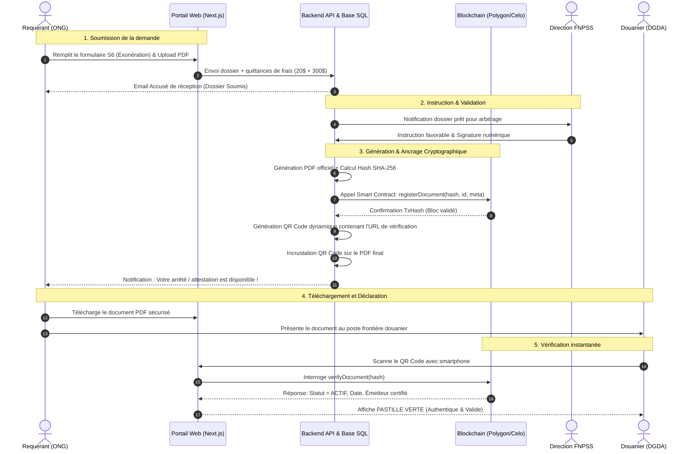
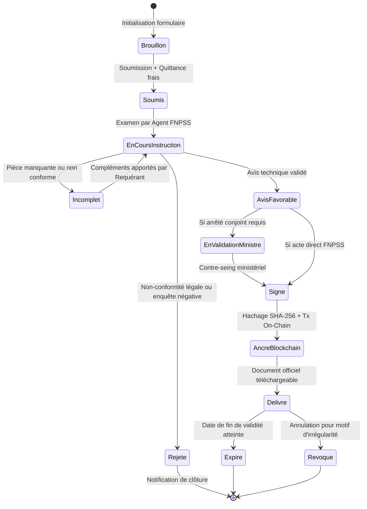

# GUICHET UNIQUE DÉMATÉRIALISÉ DU FNPSS
## Spécifications Fonctionnelles, Cas d'Utilisation et Scénarios Théoriques

> [!IMPORTANT]
> **Nature de ce document.** Spécification théorique construite à partir de [GUICHET UNIQUE FNPSS.pdf](GUICHET%20UNIQUE%20FNPSS.pdf) et de la [Note technique Blockchain V3](Note_Technique_FNPSS_Blockchain_V3.pdf). Elle contient aussi des **propositions** qui n'y figurent pas : 2FA, intégration Mobile Money, circuit d'approbation multi-niveaux (agent → chef de division → DG → ministère), statistiques, API d'interopérabilité détaillée, identifiants d'actes, seuils de performance.
>
> **Écart à trancher (décision D1 / issue GOV-05) :** la présentation du guichet précise que *« toutes les procédures de traitement de dossiers resteront manuelles »* et que le FNPSS notifie le requérant en fin de traitement par le portail. Les sections sur l'instruction, les signatures et les validations ministérielles (F07 à F10, CU03, CU04, CU06) décrivent donc un **workflow numérique cible** qui n'est pas confirmé. Voir la [planification globale](PLANIFICATION_GLOBALE.md).

---

### Table des Matières
1. [Contexte et Objectifs Stratégiques](#1-contexte-et-objectifs-stratégiques)
2. [Typologie des Acteurs et Rôles](#2-typologie-des-acteurs-et-rôles)
3. [Catalogue Exhaustif des Fonctionnalités](#3-catalogue-exhaustif-des-fonctionnalités)
4. [Cas d'Utilisation Détaillés (Use Cases)](#4-cas-dutilisation-détaillés-use-cases)
5. [Scénarios Opérationnels Théoriques](#5-scénarios-opérationnels-théoriques)
6. [Modélisation Graphique (Mermaid)](#6-modélisation-graphique-mermaid)
7. [Exigences Non-Fonctionnelles et Résilience](#7-exigences-non-fonctionnelles-et-résilience)

---

### 1. Contexte et Objectifs Stratégiques

Le **Fonds National de Promotion et de Service Social (FNPSS)**, établissement public en République Démocratique du Congo placé sous la tutelle du Ministère des Affaires Sociales, Actions Humanitaires et Solidarité Nationale, met en œuvre la dématérialisation intégrale de son guichet de services.

#### 1.1 Problématiques Actuelles
* **Processus manuels et semi-numérisés :** Génération et transmission de PDF statiques vulnérables à la falsification.
* **Risque de fraude documentaire :** Problème critique lors des contrôles douaniers (DGDA) et fiscaux (DGRAD, DGI) pour les exonérations accordées aux ONG.
* **Délais et manque de visibilité :** Difficulté pour les requérants situés dans les provinces éloignées de suivre le statut réel de leurs dossiers.
* **Défiance des partenaires :** Nécessité d'assurer aux bailleurs de fonds internationaux une transparence et une traçabilité auditables.

#### 1.2 Vision de la Solution
Le Guichet Unique FNPSS est une plateforme **hybride Web2 / Web3** articulée autour de deux principes fondamentaux :
1. **Une interface usager accessible et familière (Web2) :** Utilisation fluide sur mobile, tablette et PC (*Mobile-First*), masquant la complexité technique de la blockchain aux utilisateurs non avertis.
2. **Un ancrage cryptographique immuable (Web3 - Blockchain) :** Enregistrement de l'empreinte numérique (*Hash SHA-256*) de chaque acte administratif délivré sur un réseau blockchain de Layer 2 (Polygon ou Celo), couplé à un **QR Code dynamique** vérifiable instantanément sur le terrain.

---

### 2. Typologie des Acteurs et Rôles

```
+---------------------------------------------------------------------------------------+
|                                    ACTEURS DU SYSTÈME                                 |
+---------------------------+---------------------------+-------------------------------+
| ACTEURS EXTERNES          | ACTEURS INTERNES FNPSS    | ACTEURS INTER-INSTITUTIONNELS |
+---------------------------+---------------------------+-------------------------------+
| - Requérant (ONG, ASBL,   | - Agent Instructeur       | - Ministère de tutelle        |
|   Fondation, Partenaire)  | - Chef de Division Métier | - Régie Douanière (DGDA)      |
| - Grand Public / Tiers    | - Direction Générale (DG) | - Ministères signataires      |
|   Vérificateur            | - Administrateur Système  |   (Plan, Finances, etc.)      |
+---------------------------+---------------------------+-------------------------------+
```

1. **Le Requérant :**
   * Représentant d'une structure humanitaire, d'une ONG nationale ou internationale, d'une association confessionnelle ou d'un opérateur social.
   * Actions : Créer son profil, déposer une requête, téléverser les justificatifs, payer les frais, suivre le traitement, télécharger l'acte scellé.
2. **L'Agent Instructeur FNPSS :**
   * Réceptionne les dossiers, vérifie la complétude des pièces exigées, contrôle l'éligibilité légale et instruit l'enquête sociale/technique.
3. **Le Chef de Division / Validateur FNPSS :**
   * Effectue la revue hiérarchique, émet un avis motivé (favorable ou défavorable), prépare le projet d'attestation ou de certificat.
4. **La Direction Générale (DG) du FNPSS :**
   * Approbateur final au sein de l'établissement, valide et signe électroniquement les documents, initie l'ancrage blockchain ou transmet aux ministères compétents.
5. **Le Ministère de tutelle / Ministères Partenaires (Affaires Sociales, Finances, Plan) :**
   * Pour les actes conjoints (notamment les arrêtés interministériels portant avis favorable pour l'exonération des droits et taxes), interventions en validation multi-signatures (*Multisig*).
6. **L'Agent de Contrôle Douanier / Fiscal (DGDA) :**
   * Inspecteur au poste frontière, port ou aéroport. Scanne le QR Code présent sur le document du requérant pour vérifier son authenticité en direct sans compte complexe.
7. **L'Administrateur Système :**
   * Paramètre les référentiels, configure les rôles (RBAC), surveille les nœuds blockchain / relayeurs et assure la maintenance de la plateforme.

---

### 3. Catalogue Exhaustif des Fonctionnalités

#### 3.1 Module Authentification, Compte & Profil Usager
* **F01 - Authentification Hybride (Web2/Web3) :**
  * Connexion classique par e-mail et mot de passe sécurisé.
  * Connexion rapide par OAuth 2.0 (Google Workspace / Gmail).
  * Génération transparente d'un portefeuille cryptographique non-custodial via Account Abstraction (*Web3Auth / Magic.link*). L'utilisateur ne gère aucune seed phrase.
* **F02 - Gestion du Profil Institutionnel :**
  * Renseignement de la dénomination, du numéro d'enregistrement (F92, arrêté d'agrément, numéro d'identification nationale).
  * Coordonnées des représentants légaux et délégués.
  * Historique des pièces déjà validées (évite de réimporter les statuts à chaque démarche).
* **F03 - Récupération et Sécurité de Compte :**
  * Procédure de réinitialisation de mot de passe par lien signé temporaire.
  * Authentification à deux facteurs (2FA par OTP email/SMS/authenticator).

#### 3.2 Module Catalogue des Services & Soumission des Demandes
Le guichet unique couvre **6 services administratifs majeurs** :

1. **Service S1 : Attestation d'enrôlement au FNPSS**
   * Reconnaissance officielle de l'acteur humanitaire auprès du FNPSS.
2. **Service S2 : Convention de partenariat avec le Gouvernement de la RDC**
   * Accord-cadre bilatéral permettant d'opérer des programmes sociaux d'envergure.
3. **Service S3 : Attestation des biens à exonérer**
   * Liste qualitative et quantitative des équipements, véhicules, vivres ou médicaments destinés à des œuvres humanitaires.
4. **Service S4 : Certificat d'exonérations**
   * Document conférant une franchise douanière/fiscale temporaire ou permanente.
5. **Service S5 : Certificat de philanthropie**
   * Attestation d'utilité publique accordée aux donateurs et mécènes sociaux.
6. **Service S6 : Arrêté ministériel portant avis favorable pour l'exonération**
   * Acte réglementaire officiel signé par la tutelle et transmis aux ministères des Finances et du Budget.

* **F04 - Formulaires Dynamiques et Exigences Paramétrables :**
  * Saisie guidée étape par étape (*Wizard*).
  * Affichage en direct du récapitulatif des documents exigés :
    * Requête adressée au Ministre avec copie au DG FNPSS.
    * Copie de l'attestation d'enrôlement au FNPSS.
    * Copie du plan d'action pour l'année en cours.
    * Copie du rapport annuel d'activités écoulé.
    * Descriptif détaillé du projet ou programme social / humanitaire.
    * Liste détaillée des biens avec valeurs estimées.
* **F05 - Téléversement et Hachage Local des Pièces Jointes :**
  * Téléchargement de documents au format PDF/A.
  * Contrôle strict de type MIME, de taille maximale et détection antivirus.
  * Calcul automatique de l'empreinte cryptographique locale (*Client-side Hashing SHA-256*).
* **F06 - Gestion des Frais Administratifs et Quittances :**
  * Prise en compte des frais de dépôt de dossier (équivalent en Francs Congolais de 20 $ US).
  * Prise en compte des frais d'enquête de conformité (équivalent en Francs Congolais de 300 $ US).
  * Téléversement du bordereau de versement bancaire ou intégration Mobile Money.
  * Délai de traitement indicatif paramétré à 10 jours ouvrables à compter de la validation du paiement.

#### 3.3 Module Traitement, Instruction & Workflow Administratif
* **F07 - Tableau de Bord Multi-Rôles :**
  * Vue synthétique des demandes : `En attente de paiement`, `Soumis`, `En cours d'instruction`, `Enquête programmée`, `Avis favorable émis`, `Approuvé`, `Rejeté`, `Clôturé`.
  * Filtres par type de service, date de soumission, province, statut.
* **F08 - Revue documentaire & Contrôle de recevabilité :**
  * Visionneuse PDF intégrée dans l'interface agent sans téléchargement externe requis.
  * Check-list de conformité des pièces.
* **F09 - Interaction & Demande de Compléments :**
  * Messagerie intégrée liée au dossier.
  * Notification au requérant en cas de pièce illisible ou incomplète avec blocage temporaire du compte à rebours de traitement.
* **F10 - Circuit de Signatures et Validations :**
  * Circuit d'approbation séquentiel ou parallèle (Agent -> Chef de Division -> DG FNPSS -> Cabinet Ministériel).
  * Prise en charge des signatures cryptographiques internes.

#### 3.4 Module Blockchain, Notarisation & Smart Contracts
* **F11 - Génération de l'Acte Numérique Sécurisé :**
  * Production du document officiel PDF via template normé (en-tête officiel, armoiries de la RDC, logo FNPSS).
  * Génération de l'identifiant unique national (ex: `FNPSS-EXO-2026-00124`).
* **F12 - Ancrage On-Chain de l'Empreinte (SHA-256) :**
  * Calcul du Hash final du PDF généré.
  * Appel au Smart Contract de registre (*Registry Contract*) sur Polygon ou Celo via un portefeuille payeur de gaz (*Gas Relayer / Paymaster*).
  * Stockage on-chain : `Hash du document`, `Numéro d'acte`, `ID du requérant`, `Type de service`, `Date d'émission`, `Date d'expiration`, `Statut (Actif/Révoqué)`, `Clé publique du signataire`.
* **F13 - Intégration du QR Code Cryptographique Dynamique :**
  * Insertion sur le PDF d'un QR code pointant vers l'URL publique de vérification contenant la signature et le hash de l'acte.
* **F14 - Révocation et Suspension On-Chain :**
  * En cas d'irrégularité ou de fraude ultérieure constatée, le FNPSS peut changer l'état du certificat sur le smart contract (`Revoked`). L'état est instantanément effectif partout dans le monde.

#### 3.5 Module Contrôle et Vérification Douanière (DGDA)
* **F15 - Portail Public de Vérification :**
  * Interface web légère et ultra-rapide optimisée pour les smartphones des douaniers aux postes frontières.
  * Scan du QR Code via la caméra du terminal ou téléversement d'un PDF suspect pour recalcul d'empreinte.
* **F16 - Restitution Instantanée de la Validité :**
  * **Pastille Verte (Authentique & Valide) :** Affiche le document certifié, les dates, les biens exonérés autorisés et le cachet FNPSS.
  * **Pastille Rouge (Faux / Document Altéré / Révoqué) :** Signalement d'incohérence entre le PDF présenté et l'empreinte inscrite sur la blockchain.
  * **Pastille Grise (Expiré) :** Document authentique mais dont la période de franchise est échue.

#### 3.6 Module Suivi, Notifications & Audit
* **F17 - Centre de Notifications Temps Réel :**
  * Notifications sur l'espace usager et par e-mail automatique.
* **F18 - Journal d'Audit Immuable (Log Traceability) :**
  * Historisation de chaque action : dépôt, consultation, validation, émission, scan douanier.
* **F19 - Statistiques et Décisionnel (Reporting) :**
  * Suivi du volume des exonérations accordées, volumétrie par province et par nature de biens.

---

### 4. Cas d'Utilisation Détaillés (Use Cases)

#### CU01 : Création de Compte et Connexion Usager
* **Acteur principal :** Requérant (ONG, Association).
* **Préconditions :** L'utilisateur dispose d'une adresse email valide ou d'un compte Google.
* **Déclencheur :** L'utilisateur clique sur « Connexion à votre compte » ou « Créer un compte ».
* **Scénario Nominal :**
  1. Le requérant renseigne son email et son mot de passe (ou sélectionne « Connexion Google »).
  2. Le système vérifie les identifiants.
  3. En arrière-plan, le module Web3Auth dérive une clé publique/privée associée au compte (Account Abstraction).
  4. Le système redirige l'utilisateur vers son tableau de bord requérant.
* **Extensions / Alternatives :**
  * *1a. Mot de passe oublié :* L'utilisateur clique sur « Mot de passe oublié », reçoit un lien de réinitialisation sécurisé par e-mail et définit un nouveau secret.
  * *2a. Identifiants incorrects :* Message d'erreur explicite, invitation à réessayer ou réinitialiser.

---

#### CU02 : Soumission d'une Demande d'Exonération ou d'Arrêté
* **Acteur principal :** Requérant.
* **Acteurs secondaires :** Système de stockage sécurisé, API FNPSS.
* **Préconditions :** Le requérant est authentifié, son profil structure est renseigné.
* **Scénario Nominal :**
  1. Le requérant consulte son tableau de bord et clique sur « Commencer par ici » sous le service désiré (ex: *Arrêté ministériel portant avis favorable pour l'exonération*).
  2. Le système affiche le formulaire spécifique et rappelle les pièces exigées ainsi que les frais (20 $ dépôt + 300 $ enquête).
  3. Le requérant remplit les champs obligatoires (intitulé du projet, description, montant estimatif des biens, liste des colis).
  4. Le requérant téléverse les pièces jointes exigées :
     * Requête adressée au Ministre / DG.
     * Copie de l'attestation d'enrôlement FNPSS.
     * Plan d'action annuel.
     * Rapport d'activités.
     * Descriptif du projet humanitaire.
     * Bordereau de preuve de paiement des frais administratifs.
  5. Le requérant valide la soumission.
  6. Le système calcule les empreintes locales, téléverse les fichiers de manière chiffrée, attribue un numéro de dossier unique (ex: `FNPSS/DEM/2026/048`) et passe l'état à `Soumis`.
  7. Un email de confirmation contenant l'accusé de réception numérique est transmis au requérant.
* **Extensions / Alternatives :**
  * *4a. Fichier manquant ou format non conforme :* Blocage du bouton d'envoi et surbrillance des champs erronés.
  * *4b. Coupure de connexion durant l'envoi :* Le module PWA enregistre localement le brouillon et propose une reprise dès reconnexion.

---

#### CU03 : Instruction et Contrôle de Recevabilité
* **Acteur principal :** Agent Instructeur FNPSS.
* **Préconditions :** Une demande est à l'état `Soumis`.
* **Scénario Nominal :**
  1. L'agent accède à la file des dossiers en attente sur son portail d'administration.
  2. Il ouvre le dossier et consulte les pièces justificatives via le visualiseur intégré.
  3. Il vérifie la validité de la quittance bancaire des frais de dossier et d'enquête.
  4. Toutes les pièces étant valides, l'agent clique sur « Valider la recevabilité » et programme la phase d'instruction technique.
  5. Le statut du dossier passe à `En cours de traitement`.
  6. Une notification automatique est envoyée au requérant.
* **Extensions / Alternatives :**
  * *3a. Pièce non conforme ou douteuse :* L'agent coche « Demande de complément », saisit un message circonstancié (ex: *« Le rapport d'activité 2025 n'est pas signé »*). Le dossier passe à l'état `Complément requis`. Le requérant reçoit un email avec un lien direct pour re-téléverser la pièce demandée.

---

#### CU04 : Approbation Hiérarchique, Signature et Ancrage Blockchain
* **Acteurs principaux :** Direction Générale du FNPSS, Smart Contract Blockchain.
* **Préconditions :** L'instruction technique est favorable, l'enquête est conclue positivement.
* **Scénario Nominal :**
  1. Le Directeur Général (ou le collège des signataires) accède au dossier instruit.
  2. Il clique sur « Valider et Générer le Document Officiel ».
  3. Le système assemble le document final sécurisé (PDF) comprenant toutes les métadonnées officielles.
  4. Le système calcule le hash cryptographique SHA-256 du document (ex: `0x7f83b1...`).
  5. Le service backend initie une transaction vers le Smart Contract déployé sur Polygon/Celo pour sceller le hash, la date et le signataire.
  6. La transaction est minée et renvoie un identifiant de transaction (*TxHash*).
  7. Le système intègre sur le PDF le QR Code final (encapsulant l'URL de vérification liée au TxHash).
  8. Le document officiel est archivé dans le coffre-fort numérique souverain.
  9. Le statut de la demande passe à `Validé - Document Disponible`.
  10. Le requérant reçoit une notification de mise à disposition de son document.

---

#### CU05 : Contrôle et Vérification par la Douane (DGDA)
* **Acteur principal :** Agent de douane (DGDA).
* **Préconditions :** Le transporteur ou l'ONG présente un certificat FNPSS papier ou sur écran lors du passage en frontière.
* **Scénario Nominal :**
  1. L'agent douanier ouvre l'appareil photo de son smartphone/tablette sur l'URL publique du vérificateur FNPSS (`guichet.fnpss.cd/verifier`).
  2. Il scanne le QR code figurant sur le document.
  3. L'application extrait le hash et interroge directement le Smart Contract sur la blockchain.
  4. La blockchain confirme la présence et la validité de l'empreinte.
  5. L'écran affiche une **Pastille Verte « Certificat Authentique et Valide »** avec :
     * Nom de l'ONG bénéficiaire.
     * Nature et quota des biens exonérés.
     * Date de délivrance et date d'expiration.
  6. L'agent autorise le franchissement en franchise douanière.
* **Extensions / Alternatives :**
  * *4a. Empreinte introuvable ou modifiée (faux document altéré sous Photoshop/Word) :* L'écran affiche une **Pastille Rouge « Alerte : Document Invalide ou Falsifié »**. L'agent retient la marchandise et déclenche le protocole de contrôle des fraudes.
  * *4b. Document révoqué préventivement :* L'écran affiche **Pastille Rouge « Document Révoqué le [Date] par le FNPSS - Motif : Suspension administrative »**.

---

#### CU06 : Révocation Administrative d'un Acte
* **Acteur principal :** Direction Générale FNPSS / Ministère.
* **Préconditions :** Un document authentifié a été délivré mais une irrégularité ou un abus est constaté sur le terrain.
* **Scénario Nominal :**
  1. L'administrateur habilité recherche l'acte via son numéro d'enregistrement.
  2. Il sélectionne l'option « Révoquer le certificat », indique le motif légal et confirme son action par double authentification.
  3. Une transaction de révocation est envoyée au Smart Contract sur la blockchain.
  4. L'état on-chain de l'empreinte passe de `ACTIVE` à `REVOKED`.
  5. Désormais, tout scan douanier ou fiscal renverra immédiatement l'alerte de révocation.
  6. Les régies financières (DGDA, DGRAD) et l'ONG sont notifiées du retrait de la franchise.

---

### 5. Scénarios Opérationnels Théoriques

#### Matrice des Scénarios

| ID | Intitulé | Acteurs Impliqués | Type | Issue Théorique |
|---|---|---|---|---|
| **SC-01** | Cycle complet nominal d'exonération permanente | Requérant, Agent FNPSS, DG, Douane | Nominal | Document émis, ancré blockchain, vérifié vert en douane. |
| **SC-02** | Dépôt avec pièces incomplètes et régularisation | Requérant, Agent Instructeur | Alternatif | Aller-retour interactif, reprise sans perte de données. |
| **SC-03** | Détection d'une tentative de falsification douanière | Fraudeur, Agent DGDA, Portail Vérif | Exceptionnel | Échec de concordance de hash, alerte rouge immédiate. |
| **SC-04** | Opération en zone provinciale à faible connectivité | Requérant ou Agent terrain | Exceptionnel | Fonctionnement en PWA offline queue, sync automatique. |
| **SC-05** | Refus motivé après enquête sur le terrain | Agent Instructeur, DG, Requérant | Alternatif | Notification de rejet motivé, archivage du dossier. |

---

### 6. Modélisation Graphique (Mermaid)

#### 6.1 Diagramme Global des Cas d'Utilisation

```mermaid
flowchart TD
    subgraph Acteurs
        REQ[Requérant : ONG / Partenaire]
        AGT[Agent Instructeur FNPSS]
        DIR[Direction Générale FNPSS]
        MIN[Ministères Tutelle / Finances]
        DOU[Agent Douanier DGDA]
    end

    subgraph Portail Web - Guichet Unique
        UC1[Créer un compte & Connexion]
        UC2[Consulter le catalogue des services]
        UC3[Soumettre une demande & Pièces jointes]
        UC4[Payer les frais & Quittance]
        UC5[Suivre le statut en temps réel]
        UC6[Télécharger l'acte officiel scellé]
        
        UC7[Examiner recevabilité des pièces]
        UC8[Demander complément d'informations]
        UC9[Instruire l'enquête de conformité]
        
        UC10[Valider et Signer numériquement]
        UC11[Validation conjointe interministérielle]
        UC12[Générer le PDF sécurisé avec QR Code]
        
        UC13[Sceller le Hash sur la Blockchain]
        UC14[Scanner et vérifier authenticité instantanée]
        UC15[Révoquer un certificat frauduleux]
    end

    REQ --> UC1
    REQ --> UC2
    REQ --> UC3
    REQ --> UC4
    REQ --> UC5
    REQ --> UC6

    AGT --> UC7
    AGT --> UC8
    AGT --> UC9

    DIR --> UC10
    DIR --> UC12
    DIR --> UC13
    DIR --> UC15

    MIN --> UC11
    MIN --> UC10

    DOU --> UC14
    UC12 -.-> UC13
    UC14 -.-> UC13
```



---

#### 6.2 Diagramme de Séquence : De la Soumission au Contrôle Douanier



---

#### 6.3 Cycle de Vie d'une Demande (Machine à États)



---

### 7. Exigences Non-Fonctionnelles et Résilience

#### 7.1 Architecture Hybride et Souveraineté des Données
* **Principe d'indifférenciation cryptographique :** Aucune donnée à caractère personnel, financière ou stratégique n'est écrite en clair sur la blockchain.
* Seul le condensat mathématique (**Hash SHA-256**) est ancré publiquement. Il est impossible de reconstituer le contenu d'un document à partir de son empreinte, garantissant la conformité stricte à la protection des données publiques et privées de la RDC.
* Les fichiers sources et bases de données applicatives sont hébergés sur des infrastructures serveurs locales en RDC ou cloud souverain sous contrôle exclusif de l'État.

#### 7.2 Tolérance aux Défaillances Réseau (Offline-First / PWA)
* L'application web intègre un *Service Worker* et une base locale *IndexedDB*.
* Si un agent ou un requérant valide une opération durant une coupure de réseau, l'état est mis en attente dans une file d'attente locale asynchrone (*offline queue*).
* Dès que la connectivité internet est rétablie, les paquets et signatures sont transmis sans nécessiter de ressaisie manuelle ni risquer de doublon.

#### 7.3 Économie de Gaz et Performance Blockchain
* Le choix d'une blockchain Layer 2 (Polygon ou Celo) garantit un coût par transaction inférieur à **0,01 $ US** et un temps de confirmation de bloc inférieur à 3 secondes.
* Utilisation de contrats intelligents optimisés avec stockage minimal (*Gas-efficient data structures*).
* Modèle de parrainage de gaz (*Gas Station Network / ERC-4337*) permettant au FNPSS d'alimenter un compte payeur centralisé afin que les requérants n'aient jamais à acheter de cryptomonnaies.
